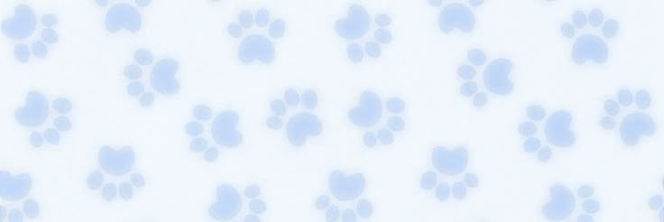
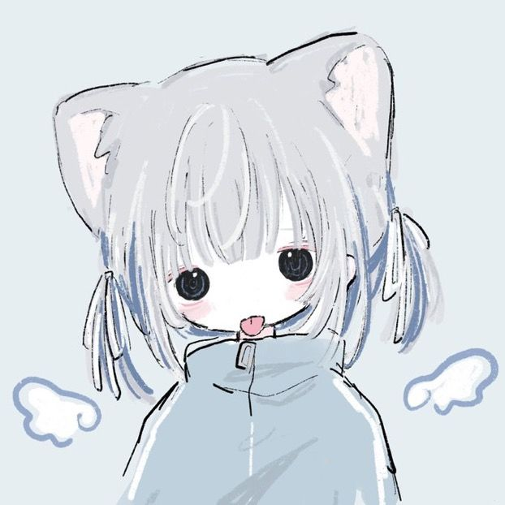

<div align="center">



<br>



# ──「 YUKKI 」──

### `mechatronics student` · `developer` · `linux enjoyer`

`[ learning • building • experimenting ]`

୨୧ ───────────────────────────────────── ୨୧

</div>

## ୨୧ About me

I'm a Mexican student focused on **Mechatronics and Robotics**, while spending a lot
of my free time exploring software, Linux and creative projects.

I like learning by building things: small programs, web experiments, game projects,
Linux configurations and anything that lets me understand how things work under the hood.

> `quiet workspace · blue themes · clean interfaces · too many side projects`

---

## ── 01 / What I do

```text
┌─────────────────────────────────────────────────────┐
│  PROGRAMMING                                        │
│  ├─ Python                                          │
│  ├─ Java                                            │
│  ├─ JavaScript / HTML / CSS                         │
│  └─ PSeInt                                          │
│                                                     │
│  CREATIVE / GAME DEV                                │
│  ├─ Unity                                           │
│  └─ 3D experimentation                              │
│                                                     │
│  LINUX                                              │
│  ├─ CachyOS                                         │
│  ├─ Niri / Hyprland                                 │
│  └─ Kitty                                           │
└─────────────────────────────────────────────────────┘
```

## ୨୧ Current interests

`01` **Software & programming** — learning Python, Java, JavaScript and web development.

`02` **Mechatronics & robotics** — automation, programming and technical systems.

`03` **Linux** — customizing CachyOS, experimenting with Wayland compositors and terminal workflows.

`04` **Game development** — Unity experiments with environments, materials, lighting and interactive ideas.

`05` **Japanese** — studying the basics, vocabulary, grammar and gradually getting familiar with kanji.

---

## ── 02 / Tech stack

<div align="center">

`Python` · `Java` · `JavaScript` · `HTML` · `CSS` · `PSeInt`

`Unity` · `Git` · `GitHub` · `Linux` · `CachyOS` · `Niri` · `Hyprland` · `Kitty`

</div>

---

## ୨୧ Things I'm building

### `EngelBot`

A small Discord bot project for a Japanese-learning community, with a sensei-inspired
personality and features for practicing kana, kanji and vocabulary.

### `Japanese learning projects`

Small web experiments for practicing Japanese, including interactive kana interfaces
and visual study tools.

### `Unity experiments`

Personal projects where I experiment with environments, materials, lighting, neon
aesthetics and interactive scenes.

### `Linux rice`

A constantly evolving desktop setup focused on a soft **tenshi kawaii** aesthetic.

```text
#F7FAFF  ── icy white
#E5F0FF  ── pale blue
#BFD9FF  ── pastel blue
#82B5F5  ── sky blue
#4F83CC  ── main blue
#315A96  ── deep blue
```

---

## ── 03 / Currently learning

```text
[██████████████░░░░░░]  Python
[████████████░░░░░░░░]  Java
[███████████░░░░░░░░░]  JavaScript
[██████████░░░░░░░░░░]  Web Development
[████████░░░░░░░░░░░░]  Japanese
[████████░░░░░░░░░░░░]  Mechatronics
```

<sub>Visual decoration only — these bars are not exact progress percentages.</sub>

---

## ୨୧ My setup

```text
OS            CachyOS / Windows
Desktop       Niri / Hyprland
Terminal      Kitty

Desktop CPU   Ryzen 5 5600
Desktop GPU   Radeon RX 6600
RAM           32 GB
Display       3440 × 1440 ultrawide

Laptop        Asus ZenBook 14 OLED
```

---

## ── 04 / Philosophy

<div align="center">

`learn → build → break → understand → improve`

୨୧ ───────────────────────────────────── ୨୧

</div>

I don't need to know everything before starting. I'd rather make something small,
understand what goes wrong, and use that knowledge on the next project.

---

<div align="center">

### ──「 thanks for visiting 」──

`୨୧` `✦` `⋆｡°✩`

<sub>made with curiosity, blue pixels and way too many configs</sub>

</div>
